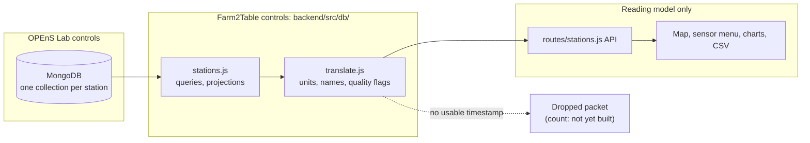

# RFC 0002: Isolating Farm2Table from the MongoDB Document Format

| Field | Value |
| --- | --- |
| Author | Aron Meraz, Deployment Owner |
| Date | 2026-10-25 |
| Last Updated | 2026-11-22 |
| Status | Accepted, partially implemented |
| Decision Date | Implementation began 2026-11-12 (commit `9c3f2e9`) |
| Deciders | Farm2Table team; OPEnS Lab project partners |
| Superseded By | N/A |

## Problem and context

**The project.** Farm2Table is a web application being built with the OPEnS Lab at Oregon State University. The lab's environmental sensor stations send packets of readings (soil moisture, temperature, humidity, pressure, air quality, gases, battery voltage, windspeeds...etc) into MongoDB. Farm2Table lets researchers, growers, students, and kiosk visitors see where stations are, what each measures, its latest values, and its history as interactive charts, with comparison and CSV export, on desktop, tablet, and mobile. It replaces the lab's older Ear2Earth viewer as a new codebase that reuses only some of Ear2Earth's query logic ([Ear-2-EarthReusableCode.md](../Ear-2-EarthReusableCode.md)).

**The part this decision touches.** Every feature depends on reading sensor documents from a MongoDB database Farm2Table does not own. The lab's firmware decides the document shape: field names, nesting, timestamp format, and units. Each collection is one station, and stations carry different sensor combinations. This RFC decides how much of Farm2Table is allowed to depend on that shape.

**What the documents actually look like.** Three real packets copied into our fixtures [translate.test.js](../../backend/tests/translate.test.js)) shows the problem concretely:

- Timestamps are strings with unpadded hours (`2026-08-19T9:34:48Z`), which sort wrong as text.
- Units are sometimes a suffix (`Temperature_C`), sometimes in parentheses (`Temp(C)`), and sometimes absent (`SEN66.PM2_5`, where the `_` is a decimal point, not a separator).
- The same sensor model appears twice on one station doing different jobs (`MS5803_118` atmospheric, `MS5803_119` hydrostatic).
- Values arrive as `null`, as strings (`'ERR'`), or as error codes outside the sensor's range (NoxIndex 655 on a 0–500 scale on station Deploy_Test_8).

**Why now.** In October no feature code existed, so a boundary cost days; after two terms of features reading raw fields, it would mean editing every query and component. The team accepted the boundary and built it first (commits `9c3f2e9`, `e858d31`, `3560a69`, `f7c0569`).

**What happens if the team does nothing.** Ear2Earth is the evidence (OPEnS Lab's previous capstone group using same database). It read raw fields in each feature, and while porting its logic we found three silent bugs ([translate.js](../../backend/src/db/translate.js) comments):

1. It applied its timestamp fix to `time_local` instead of `time_utc`, shifting every chart by the UTC offset.
2. It keyed the SEN55 display name as `Sen55`, which never matched real data.
3. It assumed gas board `_0` measures H2S; Deploy_Test_8 has `_0` measuring CO.

None crashed; each produced a plausible but wrong chart or label. A shifted or empty chart looks like a quiet day, not a bug.

To fix these mistakes they would need to go through and fix each function's logic for grabbing this information. Which takes more time than needed 

**Reversibility.** The layer is backend code and reversible. The *reading model* it outputs is not: the map, charts, comparison, and CSV export all consume it.

## Options

| Option | What it is | Real costs | Right choice when |
| --- | --- | --- | --- |
| **0. Do nothing** | Each feature queries MongoDB and reads raw fields, as Ear2Earth did | None up front; upstream changes break many features silently | The site is a short-lived prototype with one station type and no export |
| **A. Tolerant translation layer** | One backend layer maps documents to our model, reading only needed fields and inferring units from names | Days to design the model; unit inference can be wrong without warning | The format is stable and data quality trusted |
| **B. Translation plus document schema validation** | Option A, plus each document is checked against a JSON Schema (e.g. with Ajv); failing documents are rejected and logged | Schema must list every sensor set; new sensors fail until it is updated; one bad field rejects a packet | Station types are few and fixed, and a rejected packet is safer than a partly wrong one |
| **C. Stable contract from the data owner** | Ask the lab for a versioned schema or advance notice of changes | Little code; depends on the lab's priorities; catches nothing | The lab can version firmware output; best alongside another option |
| **D. Enforce in the database** | Add MongoDB `$jsonSchema` validators or read-only views that reshape documents | Needs admin rights we lack; a validator rejects the lab's own inserts | Farm2Table owned the database and its ingest path |
| **E. Tolerant layer with per-field quality flags** | Option A, plus a quality flag per *value* (`ok`, `missing`, `invalid`, `out_of_range`), explicit unit rules for known fields, and counted dropped packets | More code than A; ranges and units need lab confirmation | Formats vary and sensors appear unannounced, but bad values must stay visible |

E mixes A and B, and emerged from implementation: B's goal (bad data visible, not drawn) per field instead of per packet, with A's tolerance for new sensors. C can sit alongside any option.

## Analysis

| Criterion | 0 | A | B | C | D | E |
| --- | --- | --- | --- | --- | --- | --- |
| Places to fix after a format change | Every feature | One layer | One layer + schema | Depends on the promise | Database | One layer |
| New sensor on a station | Each feature | Appears automatically | Rejected until schema updated | Announced, maybe | Rejected | Appears automatically, flagged if no unit |
| Bad value visible to user | No | No | Whole packet dropped | No | Insert fails | Yes, per field |
| Feasible with read-only access | Yes | Yes | Yes | Yes | **No** | Yes |

**Maintainability.** The pattern is the anti-corruption layer: one layer holds all translation so the rest of the system keeps its own model, at the cost of latency and one more component ([Anti-corruption Layer pattern](https://learn.microsoft.com/azure/architecture/patterns/anti-corruption-layer)). Project evidence on the cost of B versus A/E: the three real packets in our fixtures already carry six sensor models in three different combinations (Analog, SEN55, SHT31 / Analog, three DFR gas boards, SEN66, SHT31 / MS5803 alone), and PR #18 made the sensor list dynamic because stations gain sensors over time. A whole-document schema (B) needs an entry per combination and rejects each new one. Option E's cost is a lookup table, `KNOWN_FIELDS`, used only where a field name does not carry its unit (SEN66, DFR gas boards, battery). Every reading records `unitSource` (`table`, `name`, or `none`), so fields still needing an entry are visible, not silently guessed.

**Robustness.** Fowler's Tolerant Reader advises reading only needed fields so upstream additions don't break consumers ([Tolerant Reader](https://www.martinfowler.com/bliki/TolerantReader.html)). In E, any object-valued key not in `NON_SENSOR_KEYS` is a sensor, so new sensors need no code change. The flip side: tolerance can hide a rename. A renamed field becomes a "new" field with `unitSource: 'none'`, and the old one stops updating. The verification plan watches for this.

**Correctness.** Units and time are normalized once (`m_s` and `m/s`; micro sign and Greek mu; `time_utc` only), keeping map, charts, and CSV consistent. Uncertainty: two unit rules are marked "confirm with the lab" in code (`Vbat` in volts, DFR gases in ppm), and the 0–500 index range is inferred from field names, not datasheets.

**Performance.** Translation is cheap per document; the real costs come from the format. Because timestamps are strings, every range query converts them with `$dateFromString` ([MongoDB docs](https://www.mongodb.com/docs/manual/reference/operator/aggregation/dateFromString/)) before filtering ([stations.js](../../backend/src/db/stations.js) `getReadings`), so an index on the timestamp cannot be used and each query scans the station's collection. Sensor discovery first streamed a station's whole history through Node (`getSensors`, PR #18), then moved the work into a MongoDB aggregation (`getLatestValues`, commit `f7c0569`) that returns one row per sensor field. If scans become too slow, the fix within our constraints is asking the lab for an index or a parsed date field (Option C).

**Security.** Station IDs are accepted only if they match a real collection (`router.param` in [routes/stations.js](../../backend/src/routes/stations.js)), and sensor names containing `.` or `$` are rejected (`assertSafeSensor`), so request text cannot become a field path or operator. Radio and board-test blocks are projected out (`HIDDEN_FIELDS`).

**Why not C or D alone.** C catches nothing and we cannot verify it, but our contract tests can be shared with the lab as the start of a consumer-driven contract. D is the textbook place for validation ([MongoDB Schema Validation](https://www.mongodb.com/docs/manual/core/schema-validation/)) but is ruled out by ownership (see Constraints).

## Recommendation and verification plan

**Recommendation: Option E, with C as an addition.** All code that knows the raw document shape lives in `backend/src/db/`; everything outside it uses Farm2Table's reading model.

**Where the implementation differs from the draft.** The draft recommended B and a single raw-reading module. What was built is E, bounded by the `db/` folder: `stations.js` also knows the raw shape (`$Timestamp.time_utc`, `HIDDEN_FIELDS`, `$objectToArray` over sensor keys) because MongoDB has to do the filtering and grouping. One gap remains: a packet with no usable timestamp is dropped by `toReadings` (`translate.js`, `if (!time) return []`) without being logged or counted. That is the silent loss this RFC exists to prevent; closing it is the first open item.

**Reading model** (each reading): `stationId`, `sensor`, `sensorName`, `model`, `variable`, `field`, `value` (null unless quality is `ok`), `unit`, `unitSource`, `timestamp` (UTC ISO), `quality`.

**How we know it works.** Checks run at three points: on every pull request, before every deploy.

| Check | When | Pass condition | Status |
| --- | --- | --- | --- |
| Contract tests: fixtures from three real stations and one made-up station, plus edge cases (null, `'ERR'`, out-of-range, bad/missing timestamp, unknown sensor, compound units) | Every PR to `main` ([ci.yml](../../.github/workflows/ci.yml); root `node --test` runs `backend/tests`) | All pass | **Done**: 36 tests in `translate.test.js` pass (46 in all of `npm test`) |
| MongoDB aggregation matches JS logic: `latestToSummary` output equals `summarizeSensors` for the same packets | Every PR | Equal for all fixtures | **Done** |
| One place to fix: renaming a fixture field fails only `translate.test.js` | Manual, once per term | No frontend or route test fails | Not yet run |
| No raw access: CI step fails if `from 'mongodb'` appears outside `backend/src/db/client.js`, or `Timestamp`/`time_utc` appears outside `backend/src/db/` | Every PR | Search returns nothing | Not built |
| Dropped-packet count: queries count packets with no usable timestamp and return it beside the readings | Every API call | Count reported | Not built |
| Real-data audit: script runs the layer over the last 24 hours of every station | Before each deploy and daily | Opens an issue if dropped packets exceed **1%** of a station's packets, any `out_of_range` share exceeds **5%** of a field's readings, or a new field appears with `unitSource: 'none'` | Not built |
| Visible gaps: frontend shows "unavailable" when `lastQuality` is not `ok` | Frontend test with an invalid fixture | Label shown | Not built; [App.jsx](../../frontend/src/App.jsx) shows `N/A` and ignores `lastQuality` |
| Performance: 30-day query for one sensor on the VPS | Before each deploy | Under **2 s** at p95 (target, to be checked against the measurement above) | Not measured |

The audit catches format changes before users notice a flat chart.

**What would show the decision was wrong.** Most of the site reads "unavailable" (thresholds too tight or data worse than fixtures), or renamed fields keep slipping through as new ones. The first means loosening ranges with the lab; the second, a required-fields list per known model, moving toward B for those models only.

## Constraints

- **Read-only access to a database the lab owns.** Rules out D. Condition on E: the backend connects as a read-only MongoDB user, so no code path can write or "fix" documents. Credentials live only in the git-ignored `backend/.env` ([README.md](../../README.md)).
- **The document format belongs to the lab.** Firmware can change it anytime, so E tolerates unknown fields. Unit and range assumptions must be confirmed with the lab before CSV export ships, because exported numbers leave our control.
- **Station location and owner (confidentiality).** `toMetadata` returns latitude, longitude, and owner; some research sites are on private land. Before the public map launches, the lab decides whether coordinates are exact, rounded, or hidden; the layer applies it and the metadata test checks it.

## Delegation and validation

**What I handed to AI tools.** For the draft, I used Claude to brainstorm topics fitting my role, draft the structure and candidate options, and review sources on anti-corruption layers and tolerant readers. For this final draft, I used Claude Code to check the draft against the rubric and peer reviews to confirm correctness. Claude Code also generated the Tests, and provided guidance when implementing structure.

**Checks that made that reasonable.** Every code claim here names a file or commit. Code changes went through pull requests (#14, #16, #18), and CI runs the 36 contract tests on each.

**Where I stopped and validated myself** I tested each change made by AI and ran everything locally to confirm implementations worked as intended before committing to Main. Checking code and making sure its logical. 

## Decision

**Status:** Accepted, partially implemented.

The team adopted the boundary and built Option E rather than the draft's B, for the reasons in Analysis. Still open: dropped-packet counting, the no-raw-access CI check, the real-data audit, frontend "unavailable" handling, and performance measurement. This file is updated as each closes.

## References

- Microsoft Azure Architecture Center, [Anti-corruption Layer pattern](https://learn.microsoft.com/azure/architecture/patterns/anti-corruption-layer)
- Martin Fowler, [Tolerant Reader](https://www.martinfowler.com/bliki/TolerantReader.html)
- MongoDB Manual, [Schema Validation](https://www.mongodb.com/docs/manual/core/schema-validation/)
- MongoDB Manual, [$dateFromString](https://www.mongodb.com/docs/manual/reference/operator/aggregation/dateFromString/)
- Ajv JSON Schema validator, [ajv.js.org](https://ajv.js.org/)
- Node.js, [Test runner](https://nodejs.org/api/test.html)
- Project files: `backend/src/db/translate.js`, `backend/src/db/stations.js`, `backend/src/routes/stations.js`, `backend/tests/translate.test.js`, `.github/workflows/ci.yml`, `frontend/src/App.jsx`, `docs/Ear-2-EarthReusableCode.md`
- Commits and PRs: `9c3f2e9` (PR #14, MongoDB logic), `e858d31` (PR #16, compound units), `3560a69` (PR #18, dynamic sensor menu), `f7c0569` (latest values via aggregation)

